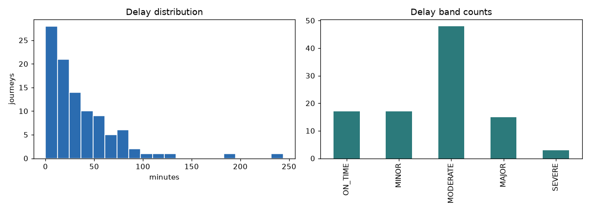
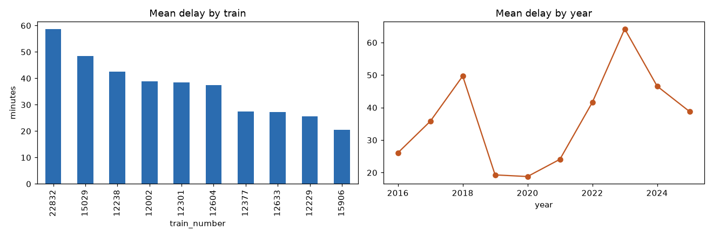
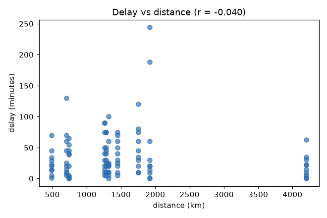

# EDA — RailPulse Indian Railways delay dataset

- Source file: `data/indian_railway_delay_data_.csv` (cleaned to `journeys_clean.parquet`)
- Rows: **100** · Columns: **19**
- Journey dates: **2016-01-01 → 2025-01-04**
- Distinct journey dates: **22**, all in month(s) **[np.int32(1)]**
- Distinct trains: **10** · routes: **10**

## Schema

| column                    | dtype          |   missing |   distinct | example             |
|:--------------------------|:---------------|----------:|-----------:|:--------------------|
| trip_id                   | str            |         0 |        100 | 12002|2016-01-01    |
| record_id                 | str            |         0 |         90 | S1                  |
| train_number              | str            |         0 |         10 | 12002               |
| train_name                | str            |         0 |         10 | Shatabdi Express    |
| source                    | str            |         0 |         10 | New Delhi           |
| destination               | str            |         0 |          7 | RANI KAMLAPATI      |
| journey_date              | datetime64[us] |         0 |         22 | 2016-01-01 00:00:00 |
| scheduled_arrival_at      | datetime64[us] |         0 |         88 | 2016-01-01 06:00:00 |
| scheduled_arrival_minutes | float64        |         0 |          8 | 360.0               |
| actual_arrival_minutes    | float64        |         0 |         79 | 370.0               |
| distance_km               | int64          |         0 |         10 | 707                 |
| season                    | str            |         0 |          1 | WINTER              |
| run_frequency             | str            |         0 |          3 | DAILY               |
| delay_minutes             | float64        |         0 |         35 | 10.0                |
| delay_minutes_stated      | float64        |         0 |         35 | 10.0                |
| delay_minutes_computed    | float64        |         0 |         36 | 10.0                |
| delay_reconciled          | bool           |         0 |          2 | True                |
| delay_band                | str            |         0 |          5 | MINOR               |
| is_significant_delay      | int64          |         0 |          2 | 0                   |

## Target: delay_minutes

|           |   value |
|:----------|--------:|
| count     | 100     |
| mean      |  36.5   |
| std       |  38.213 |
| min       |   0     |
| p10       |   5     |
| p25       |  10     |
| median    |  25     |
| p75       |  50     |
| p90       |  75     |
| max       | 244     |
| skew      |   2.581 |
| zeros     |   5     |
| negatives |   0     |
| pct_gt_15 |   0.66  |

The target is right-skewed (skew 2.58). There are **no negative delays**, i.e. the dataset records no early arrivals, which is unusual for real punctuality data and limits what the model can learn.

## Delay by segment

### By train

|   train_number |   count |   mean |   std |   median |
|---------------:|--------:|-------:|------:|---------:|
|          22832 |      10 |   58.6 | 85.71 |     20   |
|          15029 |      10 |   48.5 | 35.36 |     40   |
|          12238 |      10 |   42.5 | 32.51 |     35   |
|          12002 |      10 |   38.9 | 39.09 |     22.5 |
|          12301 |      10 |   38.5 | 24.61 |     35   |
|          12604 |      10 |   37.5 | 24.41 |     35   |
|          12377 |      10 |   27.4 | 30.35 |     20   |
|          12633 |      10 |   27.2 | 24.57 |     29.5 |
|          12229 |      10 |   25.5 | 20.46 |     21.5 |
|          15906 |      10 |   20.4 | 19.26 |     18.5 |

### By run frequency

| run_frequency   |   count |   mean |   std |   median |
|:----------------|--------:|-------:|------:|---------:|
| DAILY           |      70 |  38.39 | 41.1  |     27   |
| WEEKLY          |      20 |  34.45 | 31.24 |     26.5 |
| TRI_WEEKLY      |      10 |  27.4  | 30.35 |     20   |

### By destination

| destination    |   count |   mean |   std |   median |
|:---------------|--------:|-------:|------:|---------:|
| Howrah         |      10 |  58.6  | 85.71 |     20   |
| Pune           |      10 |  48.5  | 35.36 |     40   |
| Jammu          |      10 |  42.5  | 32.51 |     35   |
| RANI KAMLAPATI |      10 |  38.9  | 39.09 |     22.5 |
| Chennai        |      10 |  37.5  | 24.41 |     35   |
| New Delhi      |      30 |  30.47 | 25.26 |     23   |
| Kanyakumari    |      20 |  23.8  | 21.77 |     21   |

## Cardinality and zero-variance columns

| column                    |   distinct |
|:--------------------------|-----------:|
| season                    |          1 |
| delay_reconciled          |          2 |
| is_significant_delay      |          2 |
| run_frequency             |          3 |
| delay_band                |          5 |
| destination               |          7 |
| scheduled_arrival_minutes |          8 |
| distance_km               |         10 |
| source                    |         10 |
| train_name                |         10 |
| train_number              |         10 |
| journey_date              |         22 |
| delay_minutes             |         35 |
| delay_minutes_stated      |         35 |
| delay_minutes_computed    |         36 |
| actual_arrival_minutes    |         79 |
| scheduled_arrival_at      |         88 |
| record_id                 |         90 |
| trip_id                   |        100 |

## Leakage audit

| check                                          | detail                                                                                                                                                                                  | result   |
|:-----------------------------------------------|:----------------------------------------------------------------------------------------------------------------------------------------------------------------------------------------|:---------|
| post-outcome columns excluded from features    | ['actual_arrival_minutes', 'delay_minutes_computed', 'delay_minutes_stated'] are retained for audit only and must never enter the feature set                                           | PASS     |
| target-derived columns identified              | ['delay_minutes', 'delay_minutes_stated', 'delay_minutes_computed', 'delay_reconciled', 'delay_band', 'is_significant_delay'] all derive from the target and are excluded from features | PASS     |
| trip_id is unique (no same trip in two splits) | 0 duplicated trip_id values                                                                                                                                                             | PASS     |
| trip grouping is informative                   | 100 groups for 100 rows (ratio 1.00); a ratio of 1.00 means group-aware splitting is a no-op on this dataset                                                                            | FAIL     |
| no zero-variance feature columns               | constant columns: ['season']                                                                                                                                                            | FAIL     |
